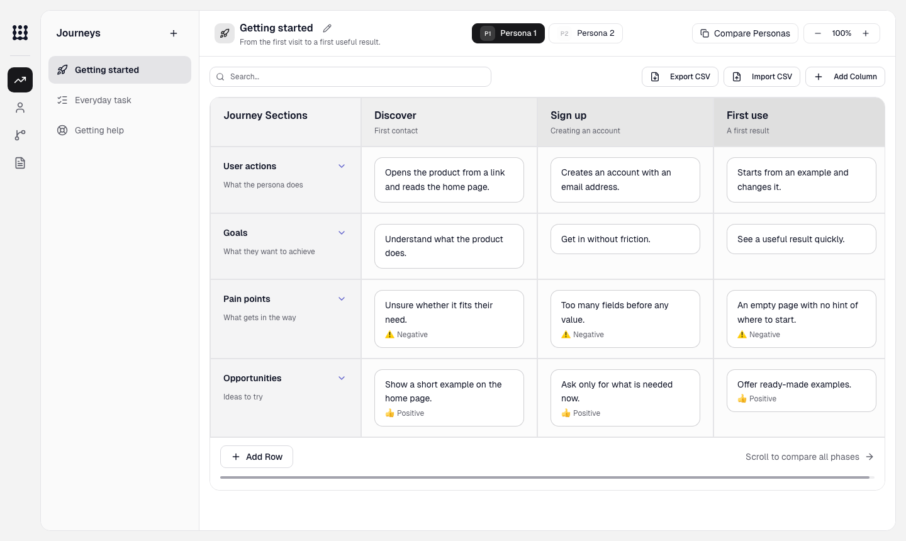

# UX Planner

A local web app for the personas, user journeys, user flows and user stories that live in your repository as Markdown and JSON. You run it against a project folder and it works on that project's `docs/ux/`. The project keeps the files and needs nothing else installed.

Because the planning files sit next to the code, they go through review with it, Git keeps their history, and a coding agent can read the flow and the story before it builds a feature.



## Install

Requires Git and Node.js 22.15 or newer (the version is pinned in `.nvmrc`). Works on macOS and Linux.

```sh
git clone https://github.com/mattiamichini-design/uxplanner.git
cd uxplanner
npm ci
npm run build
```

## Run it on a project

```sh
node /path/to/uxplanner/bin/ux-planner.mjs init --root /path/to/project
node /path/to/uxplanner/bin/ux-planner.mjs start --root /path/to/project --port 4311
```

Open http://127.0.0.1:4311/ux-planner.

`init` creates the `docs/ux/` folders and leaves existing files as they are. `start` keeps a lock file in `.ux-planner/` inside the project: add that folder to `.gitignore` and commit the planning files as usual. Each project takes one runner at a time; run several projects on different ports. Stop with Ctrl+C.

## Try the demo

```sh
node /path/to/uxplanner/bin/ux-planner.mjs demo
```

The demo opens a temporary copy of the sample workspace in `sample/` and prints its path. It has two personas, three journeys with a board for each persona so you can try comparison, and a few flows and stories. From the source checkout, `npm run demo` runs the development build.

## Planning files

```text
docs/ux/
  personas/*.md                           # YAML frontmatter + Markdown
  user-journeys/<journey>/meta.json       # title, description, icon
  user-journeys/<journey>/<persona>.json  # one board per persona
  user-flows/<flow>/*.md                  # narrative + Mermaid diagram
  user-stories/*.md                       # story + acceptance criteria
```

In the app you create and edit personas and journey boards. A journey holds several personas that you can compare side by side; you edit its columns, rows and notes with drag and drop, copy items between personas, and import or export CSV. You can also create a story. Flows are read-only, and you write flows and story content in your editor or with an agent using the [ux-planner skill](skills/ux-planner/SKILL.md).

Project names, persona slugs and journey categories come from your files. Keep slugs stable, give rows and columns unique IDs, and point cells at existing columns. Editing a persona keeps its filename and extra frontmatter fields. Journey edits and CSV imports keep `uxArtifact` links.

The app ignores files and folders starting with `.` or `_`, README files and symlinks. A document that fails validation shows an error and is never overwritten. Text files are capped at 2 MB.

## What UX Planner writes

- `docs/ux/` in your project holds the planning files you create and edit.
- `.ux-planner/runner.lock` in your project exists while a runner is active.
- `init`, `start` and `demo` add a small record with the project's absolute path to `${XDG_DATA_HOME:-~/.local/share}/ux-planner/workspaces/`. The MCP server reads these records and opens only projects listed there. Set `UX_PLANNER_REGISTRY_DIR` to use another folder, and delete a record to unlist its project.
- `demo` puts its copy in the system temporary folder.

## Use it with an AI agent

The [ux-planner skill](skills/ux-planner/SKILL.md) describes the file formats, so an agent can write flows and stories in the right place. Point your agent at it, or copy the folder to where your agent loads skills (for Claude Code, `.claude/skills/ux-planner/`).

`npm run build` also builds a stdio MCP server that works with any MCP client, such as Claude Code, Codex or OpenCode. It connects to the runner you started, lets the agent read your planning documents, add and edit journey items and create stories, and shows the UX Planner interface in clients that support MCP Apps. Add it to your client's MCP configuration:

```json
{
  "mcpServers": {
    "ux-planner": {
      "command": "node",
      "args": ["/path/to/uxplanner/mcp/server.bundle.mjs"]
    }
  }
}
```

Clients with a command line can add it directly, for example `claude mcp add ux-planner -- node /path/to/uxplanner/mcp/server.bundle.mjs` or `codex mcp add ux-planner -- node /path/to/uxplanner/mcp/server.bundle.mjs`. Start the runner for your project, then start the agent in the project folder. Routing between projects, the tool list and client limits are in [docs/mcp.md](docs/mcp.md).

## Export for design tools

```sh
node /path/to/uxplanner/bin/ux-planner.mjs export --root /path/to/project > ux-planner-handoff.json
```

The handoff contains every planning document, JSON and Markdown, with its repository path. An agent connected to Figma through MCP can use it to rebuild flows, journey maps and personas in Figma. Journey boards also export to CSV from the toolbar.

## Data safety

The server listens on 127.0.0.1 only and accepts writes only from the pages it serves (matching host and origin). It is a single-user tool.

Each save validates every document it touches, checks the files for external changes and rolls back if a write fails. CSV imports validate all personas before saving any of them. Persona forms and CSV imports reject edits made against an outdated revision. Git holds the history, so commit your planning files and avoid editing the same document in the app and in an editor at once.

If the runner was killed, the next `start` clears its stale lock. If the lock belongs to a running process, check that process before deleting `.ux-planner/runner.lock`.

## Update and uninstall

To update, pull the checkout and run `npm run build` again. To uninstall, stop the runner, remove `ux-planner` from your MCP client's configuration, and delete the checkout and `${XDG_DATA_HOME:-~/.local/share}/ux-planner/`.

## Development

```sh
npm ci
npm test              # application tests
npm run test:core     # packages/core tests
npm run lint
npm run typecheck
npm run build
```

To check a release build:

```sh
npm run pack:release
npm run verify:release
```

`verify:release` installs the packed archive offline in a temporary project and exercises the production runtime on port 4327 (set `UX_TEST_PORT` to change it).

`packages/core` holds the shared journey types, CSV and navigation helpers. [docs/architecture.md](docs/architecture.md) describes how the pieces fit together and [docs/design.md](docs/design.md) the design tokens and components. Contribution guidelines are in [CONTRIBUTING.md](CONTRIBUTING.md).

## Marketing site

`site/` is the landing page, a separate Next app built as a static export.

```sh
npm run site:dev         # http://localhost:3100
npm run site:typecheck
npm run site:build       # writes site/out/
```

The landing's "Try the demo" opens `/demo`, the real interface running in the browser on the same sample workspace as `ux-planner demo` (`sample/`). Edits stay in that browser tab. How `/demo` runs the product code is described in [docs/architecture.md](docs/architecture.md#marketing-site-and-installable-product).

`site:dev` and `site:build` need network access: they download Clash Display from Fontshare and Archivo and JetBrains Mono from Google Fonts. Clash Display's licence allows self-hosting but not redistribution, so the file is never committed.

Set `NEXT_PUBLIC_SITE_URL` to the public origin (for example `https://uxplanner.example.com`) before `site:build`; canonical links, social cards, `robots.txt` and `sitemap.xml` use it. On Vercel it falls back to the project's production domain. `vercel.json` builds the site with `npm run site:build` and serves `site/out` with clean URLs, so `/demo` resolves without `.html`.

## License

UX Planner is released under the [MIT License](LICENSE). The bundled Geist font is licensed under the [SIL Open Font License 1.1](public/fonts/Geist-OFL.txt).
