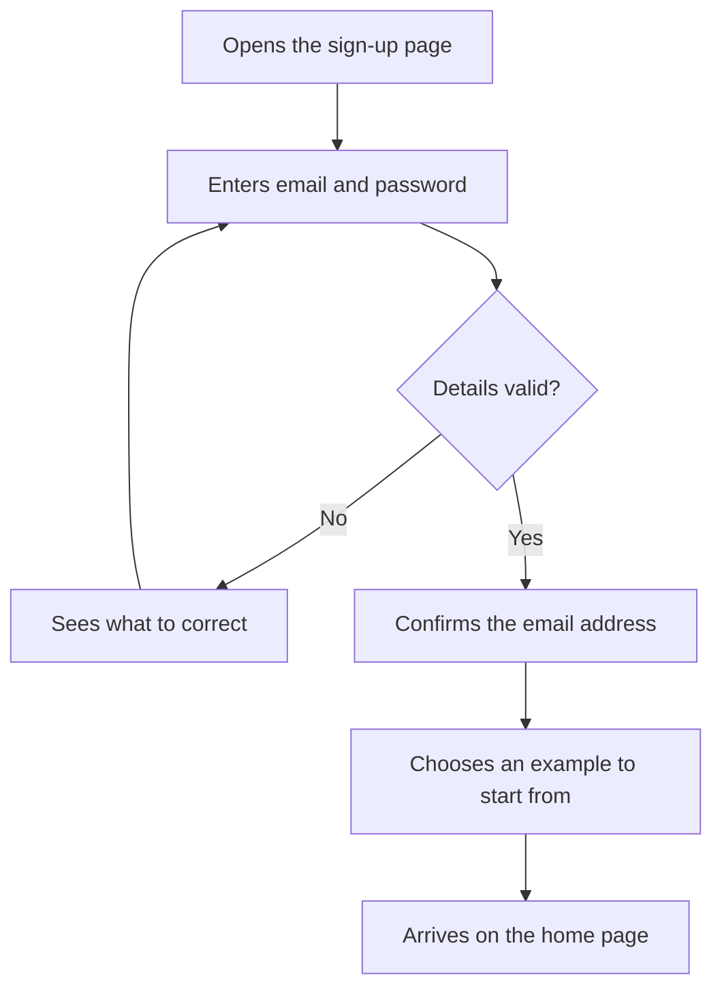

# Sign up with email

A sample flow for the UX Planner demo. The Getting started journey shows the same steps from the persona's point of view.

## Notes

- Only the fields needed now are required.
- Errors appear next to the field they refer to.
- Starting from an example is optional.
