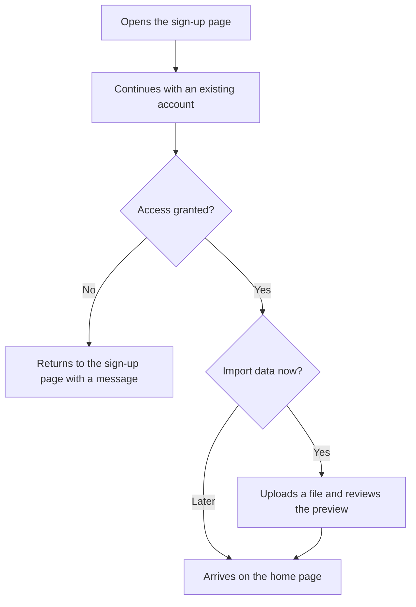

# Sign up with an existing account

A sample flow for the UX Planner demo. The Getting started journey shows the same steps from the persona's point of view.

## Notes

- No password to create.
- Import can be done later from settings.
- The preview shows problems before anything is saved.
