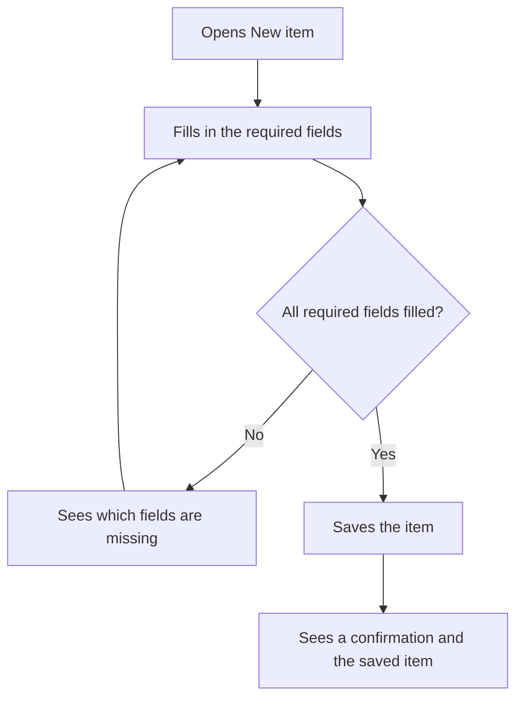

# Create an item step by step

A sample flow for the UX Planner demo. The Everyday task journey shows the same steps from the persona's point of view.

## Notes

- Each step has a short hint.
- Saving always ends with a confirmation.
