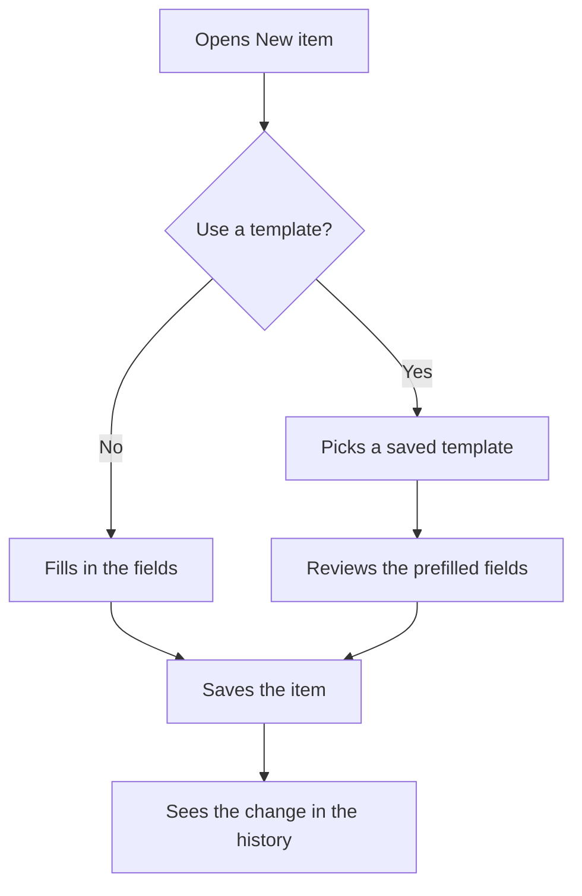

# Create an item from a template

A sample flow for the UX Planner demo. The Everyday task journey shows the same steps from the persona's point of view.

## Notes

- Templates keep the steps they repeat often.
- Every save is listed in the history.
