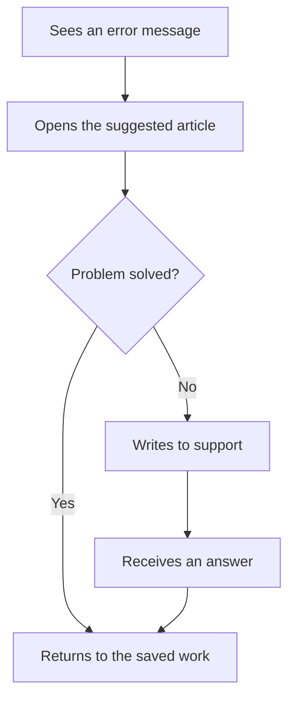

# Fix a problem with the help pages

A sample flow for the UX Planner demo. The Getting help journey shows the same steps from the persona's point of view.

## Notes

- The error links to the most relevant article.
- Work is saved before leaving the page.
