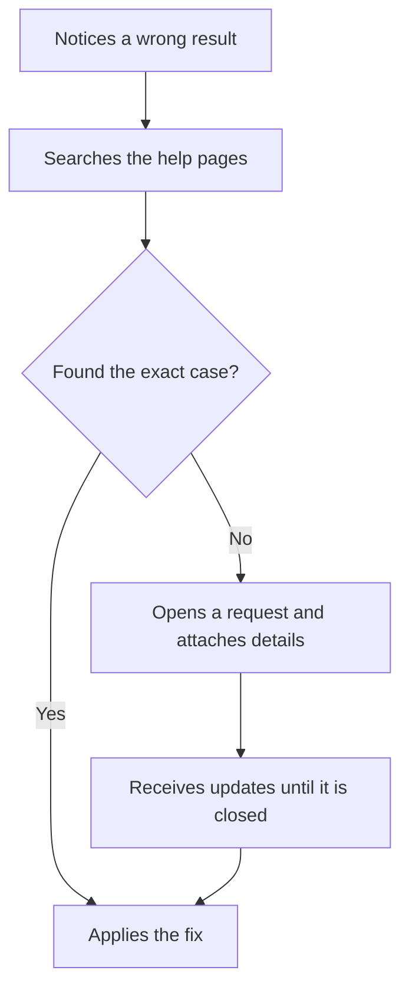

# Send a detailed request

A sample flow for the UX Planner demo. The Getting help journey shows the same steps from the persona's point of view.

## Notes

- Details are attached automatically when possible.
- Open requests show their current status.
